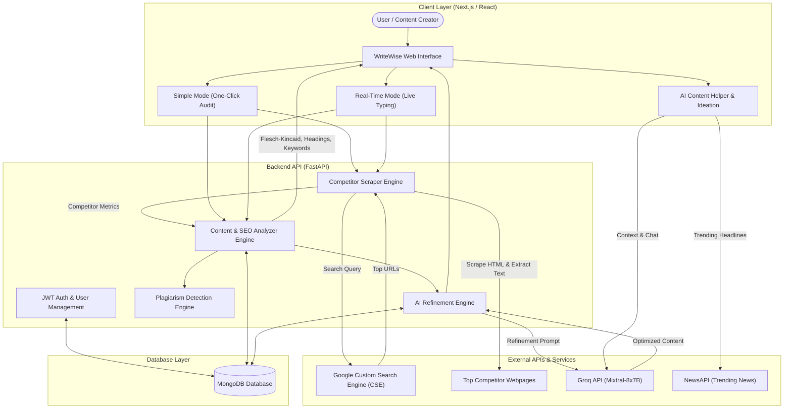

# WriteWise

> An intelligent, web-based content creation and optimization platform designed to evaluate user-written content against live, top-ranking competitors to boost search engine visibility, readability, and audience engagement.

---

> **Notice:** The full source code, backend microservices, and database models for WriteWise are maintained within a private repository for academic and intellectual property integrity. For source code access, review, or collaboration inquiries, please contact the author.

---

## Problem Statement

Writers, journalists, copywriters, and digital marketers constantly struggle to optimize digital content for search engine rankings and audience engagement. Traditional tools operate in silos:
- Grammar checkers inspect mechanics but lack search competitive awareness.
- Traditional SEO platforms focus primarily on rigid keyword quotas without interactive, real-time writing assistance.

Without data-driven comparisons against what already ranks in top Google search positions, creators face significant guesswork in keyword density, readability levels, heading structure, and content flow.

---

## Solution Overview

WriteWise bridges this gap with an all-in-one platform combining competitor benchmarking, real-time SEO scoring, readability analysis, and automated AI content refinement:

- **Live Competitor Scraping:** Queries the Google Custom Search Engine (CSE) API for user-provided keywords, scrapes top-ranking competitor articles, extracts clean text, and computes dynamic benchmark metrics.
- **SEO and Readability Benchmarking:** Analyzes word count, heading hierarchy (H1, H2, H3), link density, and readability grades (Flesch Reading Ease and Flesch-Kincaid) against industry standards and live competitors.
- **Dual Operation Modes:**
  - **Simple Mode:** Submit an article draft for a one-click audit and comprehensive metric dashboard.
  - **Real-Time Mode:** Delivers dynamic SEO score updates, keyword usage warnings, and readability feedback on-the-fly as the user types.
- **AI Content Refinement:** Automatically rewrites low-performing sections to balance keywords, optimize sentence flow, and embed structured headings via high-throughput LLM generation (Groq API).
- **AI Content Helper and Ideation:** Features an interactive AI writing assistant/chatbot and a topic recommender powered by live breaking news trends (NewsAPI) and LLM inference.
- **Integrated Plagiarism Checker:** Scans drafted and regenerated text to guarantee originality before publication.

---

## System Architecture and Flowchart

The high-level execution and data flow across WriteWise:

### Architecture Diagram

---

## Key Modules and Features

| Module | Core Functionality |
| :--- | :--- |
| **User and Profile Management** | Secure JWT-based authentication, user registration, profile settings, and session persistence. |
| **Real-Time and Simple Content Optimizer** | Live text evaluation, competitor metric comparisons (Performance Shift Radar and metric rings), and side-by-side original vs. refined comparisons. |
| **AI Content Helper (Chatbot)** | Interactive drafting, SEO advice generation, tone adjustments, and chat history tracking. |
| **AI Topic Recommender** | Trending headline fetching (NewsAPI) and automatic idea summarization (Groq API). |
| **Plagiarism Checker** | Web-similarity scoring and verification against existing online articles. |
| **Content History Management** | Dashboard to store, revisit, edit, and export previously analyzed or optimized content. |

---

## Technical Specifications

### Frontend
- **Framework:** Next.js 15 (React 18, TypeScript)
- **Styling:** Tailwind CSS
- **Rich Text Editors:** TipTap, React-Quill
- **Data Visualization:** Recharts, D3.js, React-D3-Speedometer, React-Circular-Progressbar
- **Animations:** Framer Motion

### Backend
- **Framework:** FastAPI (Python 3.10+)
- **Server:** Uvicorn (ASGI)
- **Authentication:** JWT (JSON Web Tokens) with passlib / bcrypt
- **Database:** MongoDB (Motor / PyMongo)
- **NLP and Text Metrics:** Textstat, Syllapy, NLTK, Scikit-learn
- **Web Scraping:** BeautifulSoup4, Requests

### External Services and AI Models
- **LLM Engine:** Groq Cloud (Mixtral-8x7B / Llama 3)
- **Competitor Discovery:** Google Custom Search Engine (CSE) JSON API
- **Trend Discovery:** NewsAPI

---

## Project Context

- **Academic Context:** Final Year Project (FYP) — Bachelor of Science in Data Science
- **Author:** [Muhammad Qasim](https://github.com/QASIM07J)
- **Institution:** COMSATS University Islamabad
- **Inquiries:** For access to the private source code repository or demonstration requests, please reach out via [LinkedIn](https://www.linkedin.com/in/muhammad-qasim-59604323b) or GitHub.
